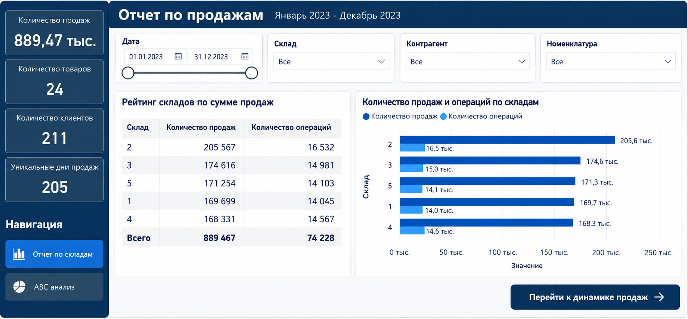
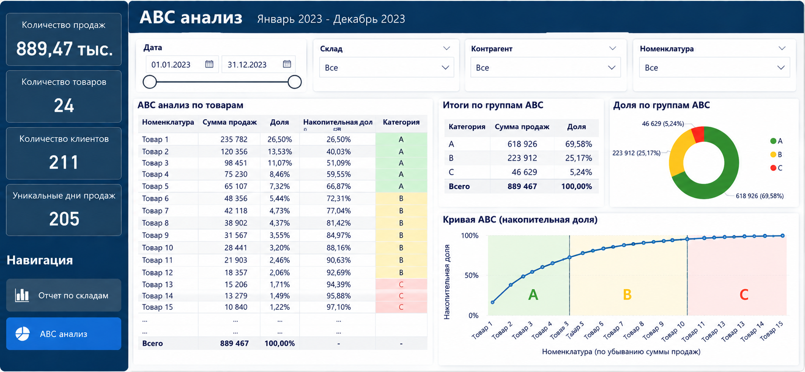

# Power BI Sales & ABC Analysis

Портфолио-проект в Power BI по анализу продаж и ABC-классификации товаров.

## Что внутри

- Отчет по продажам и складам
- 4 среза для фильтрации данных
- 4 KPI-карточки
- Рейтинг складов
- Динамика продаж по ведущим складам
- Навигация с помощью кнопок и закладок
- ABC-анализ номенклатуры
- Расчет доли и накопительной доли
- Классификация товаров по группам A / B / C

## Основные показатели

- Количество продаж
- Количество товаров
- Количество клиентов
- Уникальные дни продаж

## ABC-анализ

ABC-классификация построена по накопительной доле продаж:

- A — до 70%
- B — от 70% до 95%
- C — свыше 95%

Пример логики DAX:

```DAX
ABC =
SUMMARIZE(
    data,
    data[Номенклатура],
    "Сумма продаж", SUM(data[Количество])
)
```

```DAX
Доля =
DIVIDE(
    [Сумма продаж],
    CALCULATE(SUM([Сумма продаж]), ALL(ABC))
)
```

```DAX
Накопительная Доля =
VAR CurrentSales = ABC[Сумма продаж]
VAR TotalSales = CALCULATE(SUM(ABC[Сумма продаж]), ALL(ABC))
VAR CumSales =
    CALCULATE(
        SUM(ABC[Сумма продаж]),
        FILTER(ALL(ABC), ABC[Сумма продаж] >= CurrentSales)
    )
RETURN
    DIVIDE(CumSales, TotalSales)
```

```DAX
Категория =
SWITCH(
    TRUE(),
    [Накопительная Доля] <= 0.7, "A",
    [Накопительная Доля] <= 0.95, "B",
    "C"
)
```

## Файл проекта

Основной файл: `PowerBI_Sales_ABC_Analysis.pbix`

Для просмотра и редактирования требуется Power BI Desktop.

## Превью





## Навыки, использованные в проекте

Power BI Desktop, DAX, моделирование данных, срезы, KPI-карточки, закладки, кнопки навигации, ABC-анализ, визуализация данных.
